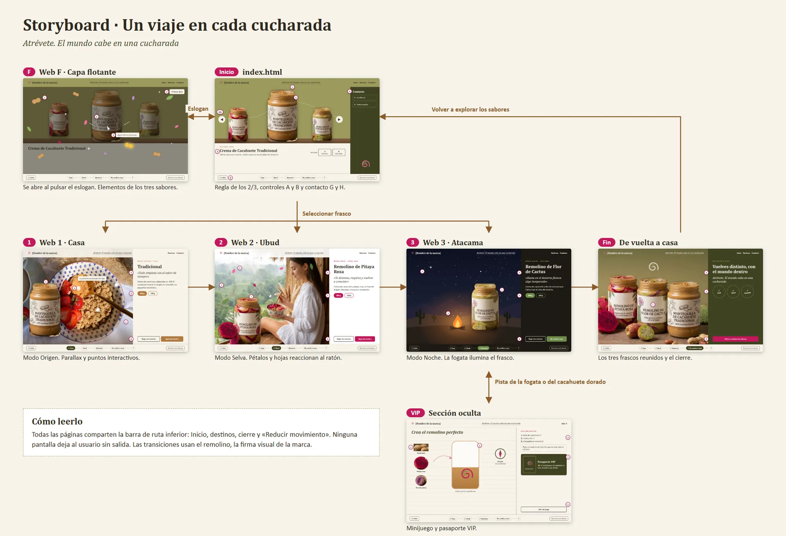
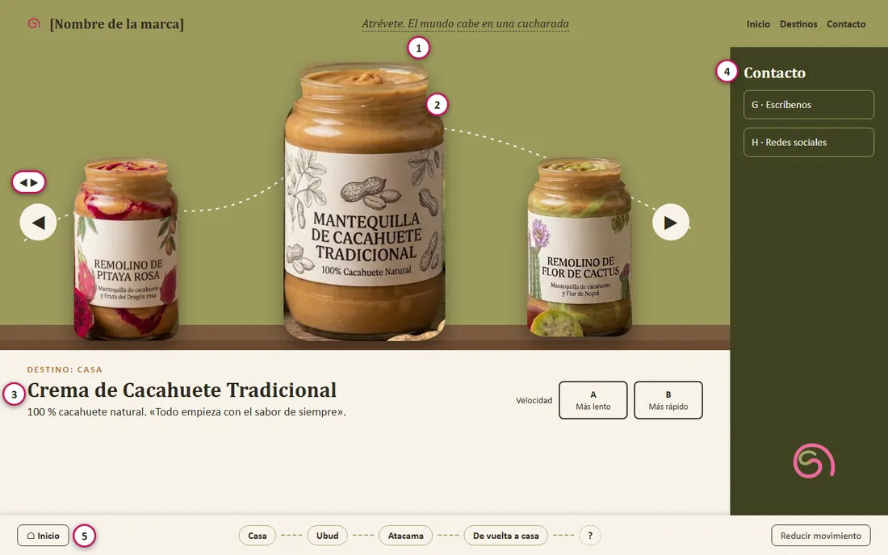
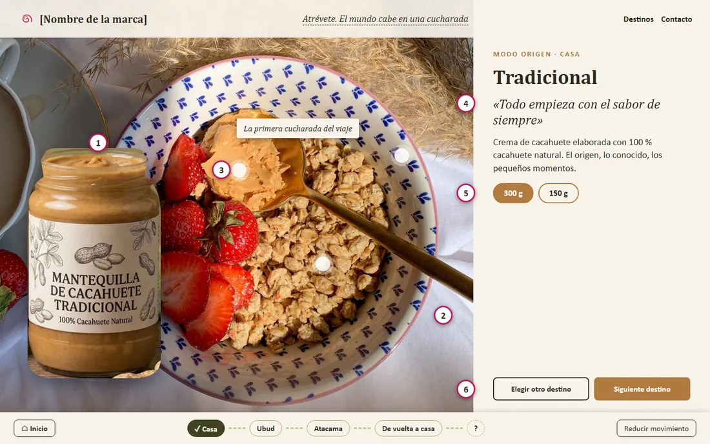
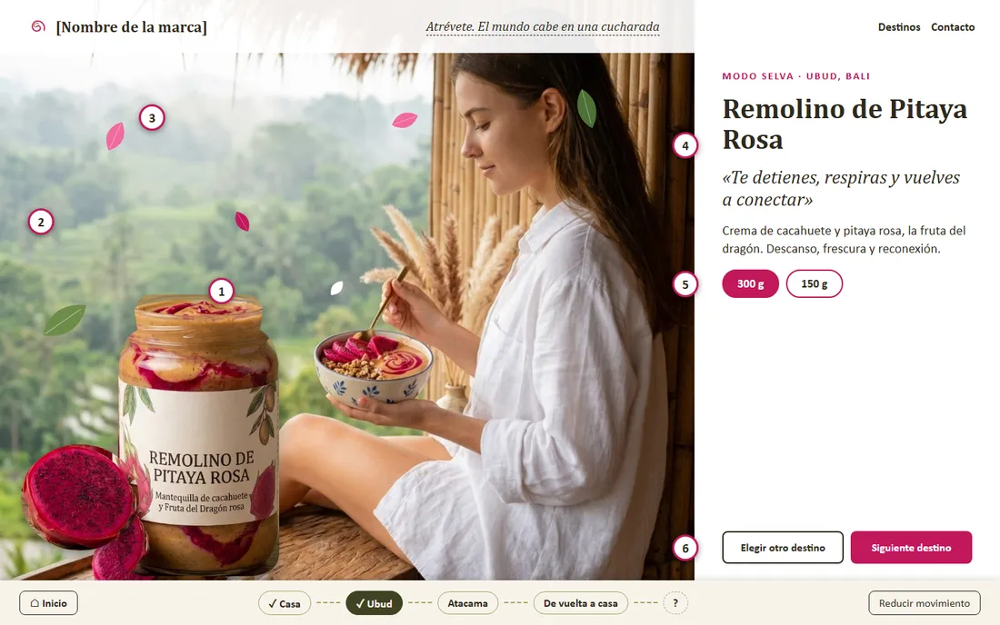
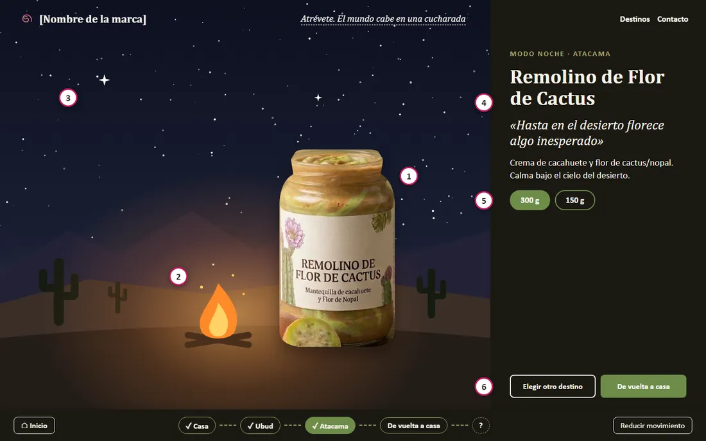
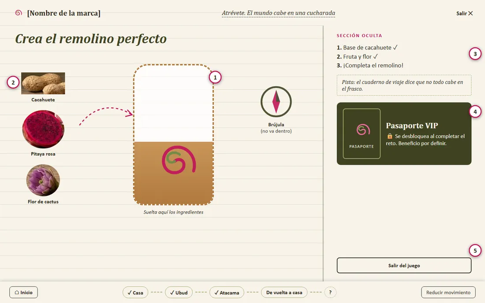
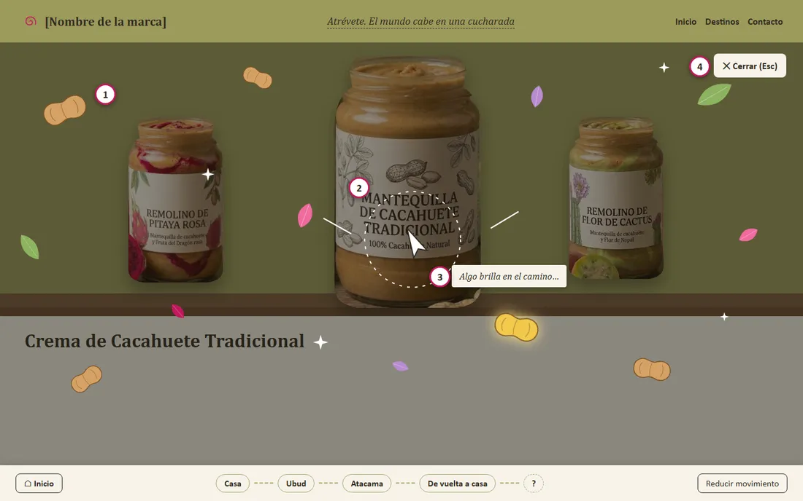
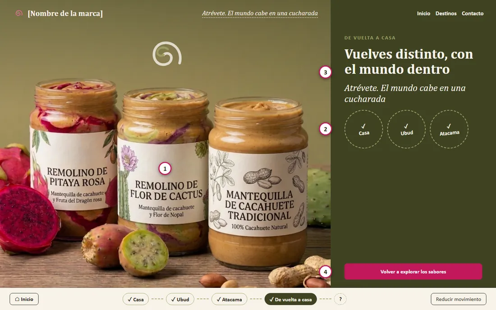

# Documentación del proyecto

Web publicitaria interactiva de Cuchavia, crema de cacahuete con frutas exóticas. Asignatura Diseño Digital y Publicidad (UGR).

La web es un anuncio interactivo, no una tienda: no tiene carrito, pagos ni precios. Cuchavia es un nombre de marca ficticio, igual que su correo de contacto.

> **Pendiente del grupo.** Rellenar los nombres de la sección 9, validar el usuario objetivo de la sección 2 y confirmar el origen de las fotos de la presentación (sección 3).

## 1. Objetivo de la web

**La web debe hacer que el usuario viva «Un viaje en cada cucharada» y recuerde los tres sabores.** Es un anuncio interactivo, de modo que el éxito no se mide en compras, sino en un recorrido completo y una marca recordada.

- **Qué debe lograr el usuario.** Conocer los tres sabores y su destino, y quedarse con el eslogan «Atrévete. El mundo cabe en una cucharada».
- **Qué debe hacer.** Elegir un frasco, explorar e interactuar con cada destino y llegar a «De vuelta a casa». Descubrir la sección oculta es opcional.

| Opción de la guía | Decisión | Motivo |
| --- | --- | --- |
| Ser un anuncio interactivo | **Elegida** | Es la que mejor representa el concepto: el mensaje se vive recorriendo destinos. |
| Publicitar el producto | Incluida | Es la finalidad de fondo, y el anuncio interactivo es la forma de conseguirla. |
| Ser la entrada a una tienda online | Descartada | No existe tienda a la que dar paso en esta fase. |
| Vender como una tienda online | Descartada | Carrito, pagos y pedidos quedan fuera del proyecto. |

## 2. Usuario objetivo

Es una **propuesta a validar por el grupo**, la misma que recoge el storyboard: no procede de ningún estudio con usuarios.

**Perfil.** Persona curiosa, a la que le atraen los sabores nuevos y los viajes, y que descubre la marca por primera vez.

- **Necesidades.** Entender pronto qué es el producto, distinguir los tres sabores y moverse sin perderse.
- **Expectativas.** Una experiencia visual cuidada que responda a sus acciones, funcione en ordenador y móvil, y no le pida comprar ni dejar sus datos.

## 3. Proceso creativo

### Evolución del concepto

El punto de partida fue el producto elegido en la presentación: una crema de cacahuete con Pitaya Rosa y Flor de Cactus, con sabores atrevidos que llevan a otro lugar. De ahí salió el concepto **«Un viaje en cada cucharada»**: cada sabor es un destino.

| Sabor | Destino | Idea | Frase |
| --- | --- | --- | --- |
| Crema de Cacahuete Tradicional | Casa | 100 % cacahuete natural | «Todo empieza con el sabor de siempre» |
| Remolino de Pitaya Rosa | Ubud, Bali | Descanso y reconexión | «Te detienes, respiras y vuelves a conectar» |
| Remolino de Flor de Cactus | Desierto de Atacama, Chile | Calma y noches estrelladas | «Hasta en el desierto florece algo inesperado» |

El recorrido sigue el mismo orden que la presentación y se cierra con «De vuelta a casa»: «Vuelves distinto, con el mundo dentro».

La presentación recoge una lluvia de 12 nombres de marca, todavía sin decidir. Como eslogan se eligió **«Atrévete. El mundo cabe en una cucharada»**, frente a otras dos ideas: «Atrévete a probar el mundo» y «Sabores que te llevan lejos».

Después del concepto se elaboró el storyboard, con la guía de la asignatura como referencia, y un prototipo estático en HTML, CSS y JavaScript. La lógica de ese prototipo se portó a React en la versión final.

### Dirección de arte y concept art

La dirección de arte se apoya en cuatro pilares visuales:

1. **Paisajes reales.** El frasco vive en el destino.
2. **Luz y texturas naturales.** Madera, lino, cerámica y fruta cortada.
3. **Ilustración botánica** de cuaderno de viaje.
4. **El remolino**, firma visual recurrente de la marca.

Las tres páginas se diferencian por color y atmósfera, pero conservan logotipo, barra de ruta, tipografía y composición para no parecer marcas distintas.

**Imágenes usadas**

| Imagen | Uso en la web |
| --- | --- |
| Recortes de los tres frascos, con la etiqueta retocada | Carrusel, destinos y pantalla final |
| Cuenco de desayuno sobre lino | Web 1, Casa |
| Persona en una ventana sobre las terrazas de Ubud | Web 2, Ubud |
| Frondas en primer plano | Web 2, Ubud |
| Capas fotográficas tratadas | Web 3, Atacama, con cielo y fogata en Canvas |
| Recortes de cacahuete, pitaya y flor de cactus | Ingredientes del minijuego; el cacahuete también en Casa |
| Ilustraciones SVG | Folios, sellos, Web F y brújula del minijuego |
| Bocetos del storyboard | Solo en esta documentación |

**Imágenes descartadas**

| Imagen | Motivo |
| --- | --- |
| Collage «Explora el viaje» | Muestra destinos fuera de los tres definidos, como los Andes, Nueva York y México. Su vivac nocturno de Atacama tiene poca resolución. |
| Llama en el altiplano | Es una escena diurna, y la Web 3, Atacama, es nocturna y gira en torno a la fogata. |
| Foto de los tres frascos juntos | La pantalla final monta los tres recortes sobre la balda, para que lleguen uno a uno. |
| Fruto del nopal suelto | Su recorte es de baja resolución, y el fruto ya aparece junto al frasco de Flor de Cactus. |
| Fondo vectorial `noche.webp` | Era una ilustración plana y el brief pide paisaje real: se sustituyó por capas fotográficas tratadas, con cielo y fogata en Canvas. |

### Origen de las imágenes

Las fotos de producto **son imágenes generadas con IA** a partir del concepto del grupo, no fotografías de un producto real. Los archivos originales conservan el nombre con el que se generaron: `Gemini_Generated_Image_*`. Son seis: los tres frascos juntos, Pitaya Rosa, Flor de Cactus, la persona en Ubud, la llama y el collage. De ellas salen los recortes de los frascos y de los ingredientes.

**El origen de las demás fotos de la presentación está por confirmar**, entre ellas el cuenco de desayuno que usa la Web 1. Hay que confirmar su procedencia y el permiso de uso antes de publicar la web fuera del ámbito de la asignatura.

Las ilustraciones SVG y las frondas de Ubud se prepararon para esta web. Las capas de Atacama salen de la imagen generada con IA `Gemini_Generated_Image_h2ar0sh2ar0sh2ar.jpg`.

### Etiquetas de los frascos

Las imágenes generadas decían «Mantequilla de cacahuete», y la presentación y la web dicen «Crema de cacahuete». Los recortes de los tres frascos se han retocado para que la etiqueta diga **«Crema»**. El grupo debe tener en cuenta que el nombre del producto queda así unificado en toda la web.

## 4. Teoría de color y paleta

La paleta combina una base cálida y apagada con acentos saturados que identifican cada destino. Los tonos de base, el cacahuete y el verde se agrupan entre los 32° y los 87° del círculo cromático, de modo que resultan análogos. La pitaya (336°) y la flor (280°) quedan al otro lado del círculo y por eso destacan sobre esa base.

El color ayuda a diferenciar las páginas: Casa es cálida, Ubud es luminosa y rosa, y Atacama es oscura. La base común mantiene la unidad de marca.

**Paleta**, con los colores de la presentación:

| Uso | Color | Hexadecimal | Tono (HUE) |
| --- | --- | --- | --- |
| Base | Crema | `#F7F3EA` | 42° |
| Base | Tinta | `#2E2A1F` | 44° |
| Base | Oliva oscuro | `#3F4322` | 67° |
| Base | Oliva | `#A3A56A` | 62° |
| Casa | Cacahuete | `#B07A3E` | 32° |
| Ubud | Pitaya | `#C2185B` | 336° |
| Ubud | Rosa | `#F06A9E` | 337° |
| Ubud y Atacama | Verde | `#6E8C4A` | 87° |
| Atacama | Flor | `#8E5FA6` | 280° |

En Atacama también se usan el cacahuete, como arena, y la tinta, como noche. La paleta falta por confirmar en la guía de diseño.

El contraste calculado de la tinta sobre crema es de 12,9:1, y el de crema sobre pitaya, de 5,3:1. Crema sobre cacahuete (3,3:1) y crema sobre verde (3,4:1) no bastan para texto de tamaño normal, así que esos colores se reservan para acentos o texto grande.

## 5. Mapa del sitio

La jerarquía tiene tres niveles: la página principal, los destinos y el cierre, y las capas o secciones que se descubren. El recorrido sugerido va de arriba abajo, pero la barra de ruta lleva a cualquier destino desde cualquier pantalla.

```text
index.html  /  Página principal: los tres frascos
│
├── /casa                Web 1, Casa, Modo Origen
│     └── siguiente destino
├── /ubud                Web 2, Ubud, Modo Selva
│     └── siguiente destino
├── /atacama             Web 3, Atacama, Modo Noche
│     └── De vuelta a casa
├── /de-vuelta-a-casa    Pantalla final
│
├── /remolino-perfecto   Sección oculta: minijuego y pasaporte VIP
│
├── Web F                Capa: se abre al pulsar el eslogan en cualquier pantalla
├── Contacto G y H       Panel lateral: se abre desde la pestaña Contacto de la cabecera y desde G y H en Inicio
│     └── /documentation Esta documentación, con enlace discreto
└── Cualquier otra ruta  Página 404: «Esta ruta no está en el mapa»
```

| Nivel | Pantallas | Papel en el recorrido |
| --- | --- | --- |
| Entrada | Página principal (`index.html`, ruta `/`) | Elegir por dónde empieza el viaje |
| Viaje | Casa, Ubud, Atacama | Conocer cada sabor en su destino |
| Cierre | De vuelta a casa | Reunir los tres frascos y dejar el eslogan |
| Descubrimiento | Web F y sección oculta | Premiar la curiosidad; nunca son obligatorias |
| Apoyo | Contacto, documentación y página 404 | Dar una salida sin romper la marca |

Las rutas se pueden escribir directamente en la barra de direcciones. En Vercel funcionan porque `vercel.json` reescribe todas a `index.html`. En el ZIP, generado con `npm run build:zip`, `index.html`, `documentacion.html` y `404.html` son la misma web: un servidor estático que entregue `404.html` en las rutas desconocidas, como GitHub Pages o Netlify, las resuelve igual, también desde una subcarpeta. Un servidor mínimo sin esa función, como `python -m http.server`, solo responde a `index.html` y `documentacion.html`, y desde ahí se navega con normalidad. Hace falta un servidor en todos los casos: con doble clic, `file://`, el navegador bloquea los módulos.

## 6. Flujo del usuario y fricción

El recorrido sugerido es lineal, pero ningún paso es obligatorio.

| El usuario quiere | Cómo lo hace |
| --- | --- |
| Entrar y descubrir los productos | Llega a `index.html` y recorre el carrusel |
| Seleccionar un sabor | Pulsa un frasco, o elige su destino en la barra de ruta |
| Explorar el destino | Interactúa con la escena y sigue con «Siguiente destino» |
| Regresar al inicio | Logotipo, «Inicio» en la barra o «Elegir otro destino» |
| Abrir la experiencia flotante | Pulsa el eslogan en cualquier pantalla |
| Descubrir el minijuego VIP | Sigue la pista de la fogata o la del cacahuete dorado |
| Completar el recorrido | Llega a la pantalla final desde la Web 3 o desde la barra de ruta |

### Puntos de fricción y solución

| Riesgo | Solución en la versión final |
| --- | --- |
| Quedar atrapado en una animación | Las transiciones son breves y se omiten con un clic, una tecla o un toque |
| Esperar al remolino del juego | «Saltar el giro», un toque en el frasco o Esc: el giro acelera y el sello cae |
| No saber cómo cerrar la Web F | Botón «Cerrar» visible y tecla Esc |
| Quedarse sin salida en el minijuego | «Salir» siempre visible; sin derrota ni tiempo límite |
| No encontrar la sección VIP | Dos pistas y un sello con interrogación en la barra de ruta |
| Perderse entre destinos | La barra de ruta marca dónde está el usuario y qué ha visitado |
| Escribir una ruta que no existe | Página 404 de la marca, con vuelta al inicio |
| Marearse con el movimiento | «Reducir movimiento» en todas las pantallas |
| Depender del cursor en móvil | Cada efecto de cursor tiene su equivalente táctil |
| Perder el dibujo del frasco si falla WebGL | La partida sigue con una versión plana en SVG y se puede ganar igual |

## 7. Las pantallas

Todas las pantallas comparten logotipo, barra de ruta con «Reducir movimiento» y transición de remolino, que se puede omitir con un clic. Cada pantalla reparte el espacio con la regla de los 2/3: dos tercios para lo visual y un tercio para texto y controles.

### Inicio (`/`), la elección

Tres frascos pasan por un carrusel con desplazamiento automático. Hay flechas, velocidad A (más lento) y B (más rápido), botón de pausa, pausa con el cursor y deslizamiento en móvil. Al seleccionar un frasco, una animación lleva a su destino. El folio ofrece los accesos G y H al panel de contacto.

### Web 1, Casa (`/casa`), el origen

Modo Origen. La mesa del desayuno tiene parallax y tres puntos interactivos: cuchara, cuenco y taza.

### Web 2, Ubud (`/ubud`), la pausa

Modo Selva, de día. Pétalos, hojas y semillas reaccionan al ratón. Hay un remolino rosa y una nota sobre la fruta. Las coordenadas del folio son las reales de Ubud: 8°30′S 115°16′E.

### Web 3, Atacama (`/atacama`), la noche

Modo Noche. El cursor sube la intensidad de la fogata, y el clic lanza llamas y chispas. La luz alcanza al frasco bajo las estrellas animadas. A la segunda avivada aparece el sello que da la pista de la sección oculta. Las coordenadas del folio son las reales: 22°55′S 68°12′O.

### Web F, la capa flotante

Se abre al pulsar el eslogan en cualquier pantalla y se cierra con un botón o con Esc. Cacahuetes, pétalos y estrellas esquivan el cursor. Algunos dan frases, y el cacahuete dorado da la pista de la sección VIP.

### Sección oculta (`/remolino-perfecto`), la recompensa

Minijuego «Crea el remolino perfecto». Se arrastran los ingredientes al frasco o, con teclado y en móvil, se elige y se pulsa. Los elementos incorrectos rebotan con una pista y no hay derrota. Al terminar, se forma el remolino, que se puede omitir, y se desbloquea el pasaporte VIP.

El pasaporte es un objeto coleccionable: un sello que queda guardado en el navegador. No promete ningún beneficio. Contenido exclusivo, una ilustración especial, una receta o un beneficio promocional siguen siendo posibilidades, porque el grupo no ha decidido qué ofrecerá.

### De vuelta a casa (`/de-vuelta-a-casa`), el cierre

Los tres frascos llegan uno a uno y aparecen los sellos de los destinos. El cierre es «Vuelves distinto, con el mundo dentro», con el botón «Volver a explorar los sabores».

### Contacto y página 404

El panel de contacto se abre desde la pestaña Contacto, en todas las pantallas, y desde G y H en Inicio. Al pie lleva un enlace discreto a esta documentación, el único de la web. La página 404 mantiene la barra de ruta y dice «Esta ruta no está en el mapa».

## 8. Bocetos del storyboard

Pulsa cualquier boceto para ampliarlo. Con las flechas se pasa de uno a otro.











## 9. Reparto del equipo

> **Por rellenar.** Falta sustituir cada [Nombre] y [Tareas] resaltados. La práctica exige indicar qué hizo cada miembro. Las áreas son orientativas y se pueden cambiar.

| Área | Responsable | Qué hizo |
| --- | --- | --- |
| Producto y presentación | [Nombre] | [Tareas] |
| Storyboard | [Nombre] | [Tareas] |
| Dirección de arte e imágenes | [Nombre] | [Tareas] |
| Desarrollo de la web | [Nombre] | [Tareas] |
| Animación e interacción | [Nombre] | [Tareas] |
| Documentación y revisión | [Nombre] | [Tareas] |

## 10. Decisiones técnicas

| Decisión | Motivo |
| --- | --- |
| React 18 y react-router-dom 6 | Cada pantalla tiene su ruta y la lógica del prototipo se reparte en componentes. |
| Vite 5 | Sirve el entorno de desarrollo y genera el sitio estático. |
| framer-motion 11 | Anima por interpolación entre estados, como pide la práctica: entradas, arrastre, modales y sellos. |
| Web Animations API (WAAPI) | La transición de remolino anima los trazos en SVG con `element.animate()`, que se puede cancelar al omitirla. |
| Canvas 2D | Cielo, fogata, chispas y humo de Atacama, y la ráfaga de pétalos de Ubud. Son cientos de partículas por fotograma. |
| WebGL | Crema del frasco del juego: un shader propio, sin bibliotecas. Sin WebGL hay una versión plana en SVG. |
| `marked` | Convierte este texto en Markdown en la página de documentación. |
| Vercel | Publica el sitio estático, sin base de datos. Todas las rutas se reescriben a `index.html`, de modo que funcionan al escribir la URL. |
| Compilación para el ZIP | `npm run build:zip` genera `dist-zip` con rutas relativas, para servirlo desde cualquier carpeta. |
| Fraunces e Instrument Sans | Títulos y textos, autoalojadas con `@fontsource-variable`. |
| `localStorage` con `try/catch` | Guarda el estado del recorrido, y la web sigue funcionando si no está disponible. |
| `prefers-reduced-motion` y «Reducir movimiento» | Detienen el movimiento; el estado final siempre se ve. |

La documentación está en `/documentation`, también en `/documentacion` y `/documentacion.html`. Se llega desde un enlace discreto en el panel de Contacto.

### Formato y resolución de imágenes

Las fotografías y capas de la web están en **WebP**, que ocupa menos que los originales en JPG y PNG y conserva la transparencia de los recortes. Los grabados, el sello y el remolino están en **SVG**, insertados en línea para que hereden el color de cada destino.

La versión compilada incluye **31 imágenes WebP**, que suman 2331 KB, y **7 ilustraciones SVG**, que suman 104 KB. Los 8 bocetos, solo para esta documentación, suman otros 532 KB.

En `src/assets/` quedan 3 archivos que ninguna pantalla importa y que, por tanto, no llegan a la web compilada: `fruto-nopal.webp`, `noche.webp`, `tres-frascos.webp`.

| Imagen | Resolución (px) | Peso (KB) | Transparencia |
| --- | --- | --- | --- |
| **Frascos e ingredientes** | | | |
| `cacahuete.webp` | 264 × 131 | 5,1 | Sí |
| `flor-cactus.webp` | 234 × 222 | 8,1 | Sí |
| `frasco-cactus.webp` | 714 × 1028 | 73 | Sí |
| `frasco-pitaya.webp` | 1151 × 1314 | 144 | Sí |
| `frasco-tradicional.webp` | 540 × 946 | 72 | Sí |
| `pitaya-cortada.webp` | 584 × 535 | 43 | Sí |
| **Casa** | | | |
| `desayuno.webp` | 1400 × 1400 | 272 | No |
| `casa/desayuno-1050.webp` | 1050 × 1050 | 150 | No |
| `casa/desayuno-700.webp` | 700 × 700 | 69 | No |
| `casa/lino-1000.webp` | 1000 × 125 | 7,1 | Sí |
| `casa/lino.webp` | 2400 × 300 | 24 | Sí |
| **Ubud: foto y frondas** | | | |
| `ubud.webp` | 928 × 1152 | 99 | No |
| `ubud/fronda-a.webp` | 900 × 760 | 111 | Sí |
| `ubud/fronda-b.webp` | 720 × 620 | 47 | Sí |
| **Atacama: capas del paisaje** | | | |
| `atacama/cactus-a-luz.webp` | 422 × 898 | 62 | Sí |
| `atacama/cactus-a.webp` | 422 × 898 | 56 | Sí |
| `atacama/cactus-b-luz.webp` | 290 × 674 | 26 | Sí |
| `atacama/cactus-b.webp` | 290 × 674 | 23 | Sí |
| `atacama/duna-1300.webp` | 1300 × 170 | 17 | Sí |
| `atacama/duna-luz-1300.webp` | 1300 × 170 | 36 | Sí |
| `atacama/duna-luz.webp` | 2600 × 340 | 90 | Sí |
| `atacama/duna.webp` | 2600 × 340 | 49 | Sí |
| `atacama/grano.webp` | 256 × 256 | 22 | No |
| `atacama/lejos-1300.webp` | 1300 × 204 | 19 | Sí |
| `atacama/lejos.webp` | 2600 × 407 | 30 | Sí |
| `atacama/medio-800.webp` | 800 × 218 | 13 | Sí |
| `atacama/medio.webp` | 1500 × 409 | 20 | Sí |
| `atacama/suelo-1400.webp` | 1400 × 355 | 57 | Sí |
| `atacama/suelo-luz-1400.webp` | 1400 × 355 | 138 | Sí |
| `atacama/suelo-luz.webp` | 2800 × 709 | 382 | Sí |
| `atacama/suelo.webp` | 2800 × 709 | 168 | Sí |
| **Bocetos, solo en esta documentación** | | | |
| `bocetos/0-storyboard-completo.webp` | 2000 × 1365 | 143 | No |
| `bocetos/1-index.webp` | 1100 × 688 | 45 | No |
| `bocetos/2-web1.webp` | 1100 × 688 | 100 | No |
| `bocetos/3-web2.webp` | 1100 × 688 | 69 | No |
| `bocetos/4-web3.webp` | 1100 × 688 | 38 | No |
| `bocetos/5-vip.webp` | 1100 × 688 | 39 | No |
| `bocetos/6-webf.webp` | 1100 × 688 | 31 | No |
| `bocetos/7-final.webp` | 1100 × 688 | 67 | No |

| Ilustración SVG | Peso (KB) |
| --- | --- |
| `ilustraciones/brujula.svg` | 12 |
| `ilustraciones/cacahuete.svg` | 14 |
| `ilustraciones/flor-nopal.svg` | 31 |
| `ilustraciones/hoja.svg` | 16 |
| `ilustraciones/pitaya.svg` | 20 |
| `ilustraciones/remolino.svg` | 0,4 |
| `ilustraciones/sello.svg` | 10 |

## 11. Estructura de archivos

El sitio vive en la carpeta `sitio/`. El prototipo estático, `web/`, se conserva como referencia y no se publica.

```text
sitio/
├── public/                   Archivos servidos tal cual
│   ├── apple-touch-icon.png
│   ├── favicon-48.png
│   ├── favicon.svg
│   └── og-imagen.jpg         Imagen para compartir el enlace
├── scripts/
│   └── postbuild-zip.mjs     Prepara las copias del ZIP
├── src/
│   ├── assets/
│   │   ├── atacama/          Capas de la noche
│   │   ├── bocetos/          Storyboard, solo en esta documentación
│   │   ├── casa/             Foto y lino de Casa, en varios anchos
│   │   ├── ilustraciones/    Grabados en SVG
│   │   ├── ubud/             Frondas
│   │   └── *.webp            11 imágenes: frascos, ingredientes y fotos
│   ├── components/           Piezas comunes y sus estilos
│   │   ├── BarraRuta.jsx     Recorrido y «Reducir movimiento»
│   │   ├── Cabecera.jsx      Marca, Contacto y eslogan
│   │   ├── cloud.css         Estilos
│   │   ├── Cloud.jsx         Partículas
│   │   ├── Contacto.jsx      Panel de contacto
│   │   ├── error.css         Estilos
│   │   ├── ErrorBoundary.jsx Pantalla de error de la marca
│   │   ├── folio.css         Estilos
│   │   ├── Folio.jsx         Ficha de cada destino
│   │   ├── index.js          Exporta todas las piezas
│   │   ├── layout.css        Estilos
│   │   ├── Layout.jsx        Marco de la web pública
│   │   ├── Pantalla.jsx      Rejilla de los 2/3
│   │   ├── piezas.css        Estilos
│   │   ├── piezas.jsx        Botón, frasco, remolino y sello
│   │   ├── transicion.css    Estilos
│   │   ├── Transicion.jsx    Transición de remolino (WAAPI)
│   │   ├── webf.css          Estilos
│   │   └── WebF.jsx          Capa flotante
│   ├── content/
│   │   └── documentacion.md  Este texto
│   ├── pages/                Pantallas
│   │   ├── Atacama.jsx       Web 3
│   │   ├── atacamaEscena.js  Cielo y fogata, en Canvas 2D
│   │   ├── Casa.jsx          Web 1
│   │   ├── cinta.js          Trazos de crema de Ubud y del Final
│   │   ├── Documentacion.jsx Esta página
│   │   ├── FichaPeso.jsx     Ficha de gramos junto al frasco
│   │   ├── Final.jsx         De vuelta a casa
│   │   ├── inicio.css        Estilos
│   │   ├── Inicio.jsx        Carrusel de los tres frascos
│   │   ├── noencontrada.css  Estilos
│   │   ├── NoEncontrada.jsx  Error 404
│   │   ├── Ubud.jsx          Web 2
│   │   ├── ubudRafaga.js     Ráfaga de pétalos, en Canvas 2D
│   │   ├── Vip.jsx           Minijuego y pasaporte
│   │   └── vipCrema.js       Crema del frasco, en WebGL
│   ├── styles/               Estilos de cada página
│   │   ├── app.css           Base común y disposiciones
│   │   ├── atacama.css       Estilos
│   │   ├── casa.css          Estilos
│   │   ├── documentacion.css Estilos
│   │   ├── ficha-peso.css    Estilos
│   │   ├── final.css         Estilos
│   │   ├── fonts.css         Fuentes autoalojadas
│   │   ├── tokens.css        Colores, tipos, espacios y movimiento
│   │   ├── ubud.css          Estilos
│   │   └── vip.css           Estilos
│   ├── App.jsx               Rutas, tema y título de cada pantalla
│   ├── ARQUITECTURA.md       Contratos del front
│   ├── data.js               Textos de marca, sabores y rutas
│   ├── DESIGN.md             Guía visual
│   ├── hooks.js              Disposiciones, táctil y capas modales
│   ├── main.jsx              Monta el estado y el enrutador
│   ├── raiz.js               Carpeta raíz, para el ZIP
│   ├── rutasDiferidas.js     Carga diferida de Ubud, Atacama y VIP
│   └── state.jsx             Estado del viaje, guardado en localStorage
├── .gitignore
├── BRIEF.md                  Briefing común del proyecto
├── index.html                Punto de entrada de Vite
├── package-lock.json         Versiones exactas
├── package.json              Dependencias y órdenes de compilación
├── vercel.json               Reescribe todas las rutas a index.html
└── vite.config.js            Compilación
```

## 12. Justificación del uso de la guía de diseño

La guía de diseño de la práctica 1 es el trabajo que fija producto, concepto, dirección de arte, nombre y eslogan. Esta tabla explica cómo se aplica cada decisión en la web y por qué se mantiene. Lo que la guía deja abierto se señala como tal, sin inventarlo.

| Decisión de la guía | Cómo se usa en la web | Por qué |
| --- | --- | --- |
| Producto: crema de cacahuete 100 % natural con frutas exóticas | Tres frascos protagonizan cada pantalla | El anuncio debe recordar el producto antes que la interfaz |
| Tres sabores, tres destinos | Una ruta por destino, con el mismo orden | La estructura del sitio repite la idea del concepto |
| Dos tamaños, 300 g y 150 g | Selector que cambia la escala del frasco, sin compra | Informa sin convertir la web en tienda |
| Concepto «Un viaje en cada cucharada» | Barra de ruta con paradas y sellos, coordenadas, pasaporte | El viaje se recorre, no solo se lee |
| Pilar 1: paisajes reales | Fotos de mesa y de Ubud; noche de Atacama por capas | El frasco vive en el destino |
| Pilar 2: luz y texturas naturales | Lino, madera, papel con grano, luz de fogata | Evita los fondos planos que rechaza la guía |
| Pilar 3: ilustración botánica | Grabados en SVG con mancha desajustada, sellos | Es el gesto de cuaderno de viaje, y escala sin perder calidad |
| Pilar 4: el remolino como firma | Logotipo, transición entre páginas y minijuego | Une las tres páginas sin que parezcan marcas distintas |
| Frases de cada destino y cierre | Se usan literalmente en folios y pantalla final | Son el mensaje de la marca |
| Eslogan «Atrévete. El mundo cabe en una cucharada» | Pestaña de la cabecera, que abre la Web F | Invita a actuar, y la web responde |
| Paleta de la presentación | Tokens de color de toda la web, más derivados para cumplir contraste AA | Mantiene la identidad y hace legible el texto |
| Nombre: 12 propuestas, sin decidir | Cuchavia en toda la web | El grupo eligió este nombre ficticio. Los bocetos conservan el marcador anterior |

## 13. Cambios respecto al storyboard y a la guía de diseño

Los cambios se han comprobado contra el código de la versión final.

### Respecto al storyboard

| Elemento | Storyboard | Versión final | Motivo |
| --- | --- | --- | --- |
| Tecnología | Prototipo estático en HTML, CSS y JavaScript | Web en React, con Vite y framer-motion | Rutas reales, estado compartido y animación por interpolación |
| Tipografía | Una serifa genérica, de maqueta | Fraunces e Instrument Sans | Fraunces cambia de grosor y suavidad en cada destino: las letras viajan |
| Cabecera | Franja con marca, eslogan y menú | Tres pestañas de cuaderno (marca, Contacto y eslogan); se quitan «Destinos» y «Storyboard» | La barra de ruta ya cubre los destinos y la imagen gana altura |
| Barra de ruta | Píldoras redondeadas | Paradas numeradas con matasellos | Solo el remolino es curvo, y el recorrido se lee como un viaje |
| Inicio | Texto bajo la balda | Texto y controles en el folio lateral | Toda la web usa la misma regla de los 2/3 |
| Velocidad del carrusel | Controles A y B | Cinco velocidades, también con A y B | Da un margen claro entre muy lenta y muy rápida |
| Pausa del carrusel | Solo con el cursor | Se añade un botón de pausa | En táctil no hay cursor, y la pausa debe existir en cualquier dispositivo |
| Contacto | Panel lateral G y H | Panel con el correo ficticio cuchavia@hotmail.com, redes «Próximamente» y enlace a la documentación | Datos ficticios facilitados por el grupo |
| Coordenadas | No aparecen | Coordenadas reales de Ubud y San Pedro de Atacama en el folio; Casa dice «las de tu mesa» | Refuerzan el cuaderno de viaje con un dato verdadero |
| Ubud | Foto a la izquierda y texto a la derecha | Pantalla invertida, con el folio a la izquierda | La mujer de la foto mira hacia el texto |
| Atacama | Ilustración provisional de fondo | Capas fotográficas tratadas, con cielo y fogata en Canvas 2D | La fogata ilumina de verdad el suelo, el frasco y el texto |
| Pantalla final | Titular en el folio | Titular sobre la pared, en el sitio del de Inicio | El viaje vuelve visualmente al punto de partida |
| Sección oculta | Un remolino dibujado sobre un relleno plano | Crema animada en tiempo real, que se vierte y gira | El remolino es la firma de la marca y la recompensa del juego |
| Sección oculta | Solo la brújula queda fuera del frasco | Se añade un sello de viaje, también incorrecto | Da más juego, y viene del prototipo |
| Salida de la sección oculta | «Salir» en la cabecera y en el folio | «Salir del juego» en el folio; en móvil y tableta vertical, «Salir» fijo sobre la ruta | Debe verse siempre, sin depender del scroll |
| Recompensa | Por definir | El pasaporte es un coleccionable, y sus posibles usos se presentan como posibilidades | Cierra el juego sin prometer lo que el grupo no ha decidido |
| Rutas no previstas | Sin definir | Página 404 de la marca | Una dirección mal escrita no debe romper la experiencia |
| Bocetos | Enlace «Storyboard» en la cabecera | Solo en esta documentación, con un enlace discreto en el panel de Contacto | El menú queda para el viaje, y la documentación sigue a mano |

### Respecto a la guía de diseño

| Elemento | Guía | Versión final | Motivo |
| --- | --- | --- | --- |
| Frascos | Plan B de foto pegada donde el recorte fallaba | Recortes rehechos, con un mismo componente para los tres | Los recortes nuevos funcionan sobre cualquier fondo, y el plan B no ha hecho falta |
| Etiquetas de los frascos | Dicen «Mantequilla de cacahuete» y toda la web dice «Crema» | Recortes retocados: la etiqueta dice «Crema de cacahuete» | Un producto no puede llamarse de dos maneras |
| Ingredientes | Medallones ovalados | Recortes sin fondo, a 168 px como máximo | Se rehicieron los recortes, y su resolución fija el tamaño |
| Remolino del juego | Trazo dibujado dentro del frasco | Crema pintada con WebGL, en los tonos de la foto del frasco; sin WebGL, una versión plana en SVG | Se pide que el remolino se forme de verdad y que parezca crema |
| Color de la flor | Verde, según el prototipo y el tema VIP | Violeta y pistacho | Son los colores del frasco de Flor de Cactus en la imagen |
| Título del juego en móvil horizontal | Sobre la página | En el folio | Así el frasco aprovecha toda la altura |
| Pasaporte en móvil vertical | En el folio | Sube junto al frasco al ganar | El sello debe verse sin hacer scroll |
| Documentación | Cabecera con la marca | Marca e índice en el lateral, sin cabecera | Es una página de lectura, sin nada encima del texto |

## 14. Revisión

El storyboard fijó tres criterios de revisión. Se aplican a la versión final así:

| Criterio | Comprobación |
| --- | --- |
| **Claridad.** Cada pantalla se entiende sin explicación | Título, frase y un solo paso principal en cada folio. Lo decide el grupo con una prueba con personas ajenas al proyecto |
| **Coherencia del flujo.** Se puede ir de la entrada al cierre sin bloqueos | Recorrido completo probado con ratón, táctil y teclado. El minijuego se ha ganado de las tres formas |
| **Efectividad.** El recorrido transmite el concepto | Pendiente de valorar por el grupo: no hay datos de uso reales |

**Dispositivos comprobados en simulación:** 320 × 568, 568 × 320, 390 × 844, 1024 × 768, 1440 × 900 y 3440 × 1440, en Chrome. La prueba en un iPhone real sigue pendiente.

**Decisiones abiertas del grupo:** reparto del equipo, usuario objetivo, confirmación de la paleta en la guía de diseño, y origen y permiso de las fotos de la presentación.
